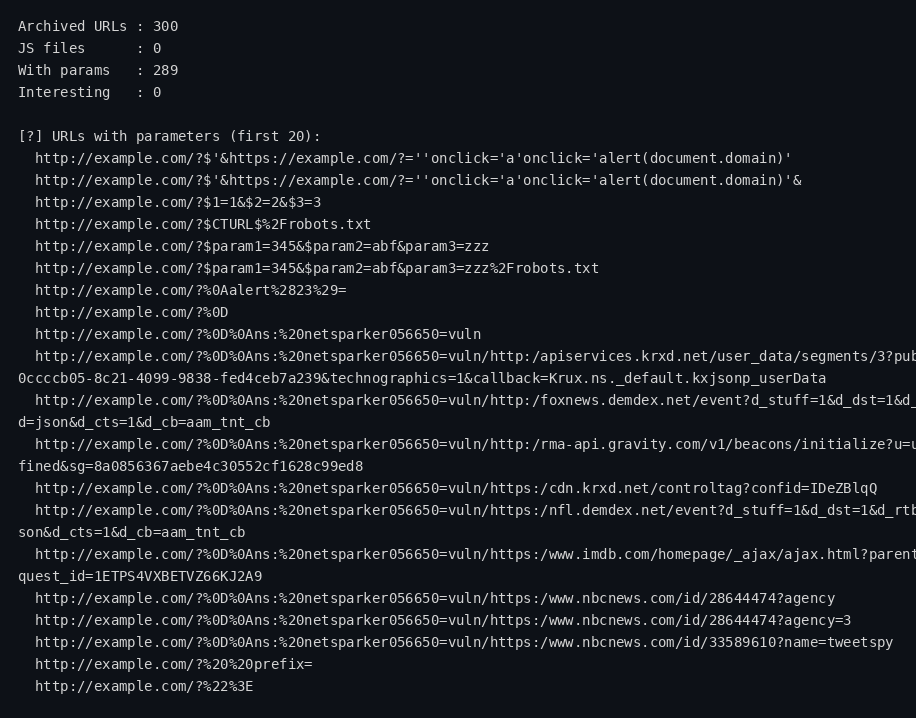

# WaybackMiner

Mine the [Wayback Machine](https://web.archive.org) for a domain's forgotten
attack surface. Passive recon — it only talks to `web.archive.org`, never
touches the target itself.

> **In simple words:** the internet keeps old copies of websites. WaybackMiner
> digs through those archived copies to find forgotten pages, links and clues —
> without ever visiting the site itself.

## What it finds

- **All archived URLs** for a domain (deduped, sorted)
- **Per-subdomain URL counts** — see where the archived surface actually lives
- **First-seen / last-seen timestamps** per URL, from the CDX capture history
- **JavaScript files** — prime recon targets
- **URLs with query parameters** — injection surface
- **Interesting files** — `.php`, `.bak`, `.sql`, `.env`, `.json`, `.git`, …
- **Duplicate content clusters** — URLs that served the identical response body (same CDX digest), i.e. the same page at many paths
- **robots.txt drift** (opt-in `--robots-drift`) — archived URLs that the domain's current robots.txt now blocks

## Install

```bash
git clone https://github.com/harshzagade/WaybackMiner.git
cd WaybackMiner
```

Stdlib only. Python 3.8+.

## Usage

```bash
python3 waybackminer.py example.com
python3 waybackminer.py example.com --js-only
python3 waybackminer.py example.com --params-only
python3 waybackminer.py example.com --interesting-only
python3 waybackminer.py example.com --json
python3 waybackminer.py example.com --subdomains-only  # per-host URL counts
python3 waybackminer.py example.com --limit 5000 -o urls.txt
python3 waybackminer.py example.com --include-status 301,403  # also mine redirect/forbidden captures
python3 waybackminer.py example.com --ext php,js       # keep only .php/.js URLs
python3 waybackminer.py example.com --no-ext bak,log   # drop backup/log captures
python3 waybackminer.py example.com --interesting-exts env,key,pem  # custom interesting set
python3 waybackminer.py example.com --mimetype image/,application/javascript  # only image + JS captures
python3 waybackminer.py example.com --collapse digest    # one row per unique response body
python3 waybackminer.py example.com --since 2020 --until 2024  # mine the 2020-2024 era only
python3 waybackminer.py example.com --dump-js js.txt --dump-params params.txt  # per-bucket files for pipelines
python3 waybackminer.py example.com --exclude-host blog.example.com  # drop one subdomain's captures
python3 waybackminer.py example.com --robots-drift  # archived URLs now blocked by robots.txt
```

## Sample run

The sample below shows the exact output format (command and result), using
`target.example` as the placeholder domain. WaybackMiner is passive recon: it
only queries `web.archive.org` and never touches the target itself.

```console
$ python3 waybackminer.py target.example --limit 2000
Archived URLs : 137
JS files      : 6
With params   : 41
Interesting   : 3
Subdomains    : 4

[!] Interesting files:
  http://target.example/backup.sql
  http://target.example/config.json
  http://target.example/debug.log

[?] URLs with parameters (first 20):
  http://target.example/search?q=test
  http://target.example/product?id=128
  ...

[*] JS files (first 20):
  http://target.example/static/app.js
  http://target.example/static/vendor/analytics.js
  ...

[#] Subdomains (top 20):
      89  target.example
      24  blog.target.example
  ...
```

When `--include-status` spans several codes, the summary gains a
`[=] Status codes` section showing how many deduped URLs were captured with
each code (missing codes are grouped under `?`) — the same breakdown is in
the `--json` report under the `statuses` key.

The summary also rolls archived URLs up by path depth (a `[=] Path depths`
section, plus the ten deepest URLs — a fast way to spot deep admin trees),
and the `--json` report carries the same counts under the `depths` key.

It also rolls them up by first-capture year (a `[=] First-seen years`
section counting deduped URLs per year of first capture, so you can see
when the archived surface grew); the `--json` report carries the same
counts under the `years` key. URLs with no known capture timestamp are
skipped from this rollup.

It also rolls them up by CDX mimetype (a `[=] Mimetypes` section with the
top 20 types, count desc); the `--json` report carries the same counts
under the `mimetypes` key. Mimetypes are lowercased, and entries with no
mimetype land under `?`.

With `--js-only`, the tool prints just the JS URL list (one per line) so you
can pipe it straight into other tools. With `--params-only`, it prints the
unique query-parameter names across the domain (sorted, one per line) — a
ready seed list for wordlist builders like ParamMiner. With
`--interesting-only`, it prints just the interesting-file URLs (`.bak`,
`.sql`, `.env`, …), one per line, for piping into downloaders or scanners.
With `--subdomains-only`, it prints per-subdomain archived-URL counts
(`host: count`, sorted by count) — a quick read of where the archived
surface actually lives.

```console
$ python3 waybackminer.py target.example --params-only
id
q
session
```

With `--json`, the tool prints the full bucketed report (all URLs, JS files,
param URLs, param names, interesting files) as machine-readable JSON — handy
for piping into `jq` or other recon tooling. Combined with `--output`, the
JSON report is written to the file instead of the plain URL list.

```console
$ python3 waybackminer.py target.example --json | head -8
{
  "all": [
    "http://target.example/about",
    "http://target.example/app.js",
    "http://target.example/backup.sql",
    ...
```

Every URL also carries a `timeline` entry — the first and last Wayback
capture timestamps seen for it (`YYYYMMDDHHMMSS`, from the CDX history),
so you can tell whether a forgotten file is still being re-crawled. The
text summary shows the overall capture window too, plus a `[~] Stale
captures` section listing the URLs whose last capture is the oldest (the
pages most likely abandoned); the same top-10 is in the `--json` report
under the `stale` key.

## Screenshots

Real run against `example.com` (a documentation-reserved domain — WaybackMiner
only queries `web.archive.org`, never the target itself):



## Tests

```bash
python3 -m unittest discover -s tests
```

## License

MIT
